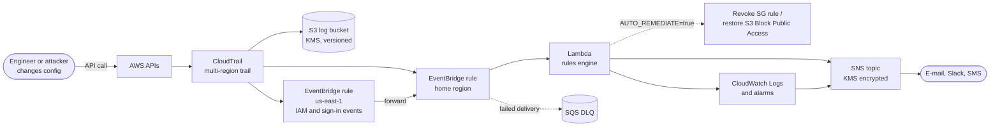

# Cloud Security Misconfiguration Detector


An event-driven AWS service that finds risky configuration changes within minutes of the API call. CloudTrail records the call, EventBridge sends it to a Lambda function, the function checks it against a set of rules, and SNS sends an alert. Two safe fixes can run automatically.

Built with Terraform, Python 3.12, CloudTrail, EventBridge, Lambda, SNS, SQS and KMS.

## Architecture



<!-- Replace with an exported diagram (for example draw.io) after you deploy:
 -->

## Demo

> **Demo video:** _placeholder. Record the steps in [Try it](#try-it) and add the link here before you delete the AWS resources._
>
> **Screenshot of an alert e-mail:** _placeholder (`docs/alert-email.png`)._

## What it detects

| Rule | Severity | Trigger (CloudTrail event) |
| --- | --- | --- |
| EC2-001 | Critical (SSH/RDP) or High | `AuthorizeSecurityGroupIngress` opens SSH, RDP, MySQL, PostgreSQL, MSSQL, Redis or MongoDB to `0.0.0.0/0` or `::/0` |
| EC2-002 | Medium | `DeleteFlowLogs` |
| S3-001 | High | `DeleteBucketPublicAccessBlock` |
| S3-002 | High | `PutBucketPublicAccessBlock` with any setting `false` |
| S3-003 | High | `PutBucketAcl` grants `AllUsers` or `AuthenticatedUsers` |
| S3-004 | High | `PutBucketPolicy` with `Principal: "*"` and no condition |
| IAM-001 | High | `AdministratorAccess`, `IAMFullAccess` or `PowerUserAccess` attached to a user, role or group |
| IAM-002 | Critical | Inline policy with `Action: "*"` on `Resource: "*"` |
| IAM-003 | Critical | Access key created for the root user |
| IAM-004 | Critical (root) or Medium | Console sign-in without MFA (IAM users and root only; SSO users are skipped) |
| CT-001 | Critical | `StopLogging` or `DeleteTrail` |
| CT-002 | High | `UpdateTrail` turns off multi-region, log file validation or KMS |
| RDS-001 | High | `CreateDBInstance` or `ModifyDBInstance` with `PubliclyAccessible: true` |

Failed API calls (calls with an `errorCode`) are ignored. HTTPS (443) open to the internet is not a finding.

### Automatic remediation

Off by default. Set `auto_remediate = true` to turn it on. Only two fixes exist, because both are safe to undo:

- **EC2-001:** revoke the exact internet-facing rule that was added.
- **S3-001, S3-002, S3-003:** turn on all four S3 Block Public Access settings for the bucket.

IAM and CloudTrail findings are alert-only. An automatic change there can lock people out. The Lambda role gets the remediation permissions only when the flag is on.

## Design decisions

- **Rules are pure functions.** `src/detector/rules.py` does not call AWS, so every rule has a unit test with a real CloudTrail event shape (`tests/events/`).
- **One list of events.** A unit test fails if a rule handles an event that the EventBridge pattern in `terraform/events.tf` does not send.
- **Global events.** CloudTrail sends IAM, STS and console sign-in events to EventBridge in `us-east-1` only. When you deploy to another region, Terraform adds a rule in `us-east-1` that forwards them to the home region.
- **No lost events.** EventBridge retries for one hour, then writes to an SQS dead-letter queue. CloudWatch alarms fire on Lambda errors and on a non-empty DLQ.
- **Encryption.** One customer-managed KMS key (rotation on) encrypts the trail logs, the SNS topic and the DLQ.
- **Least privilege.** The Lambda role can write its own logs, publish to its own topic and write to its own DLQ. Nothing else, unless remediation is on.

## Limits

- Regional events (EC2, S3, RDS) are checked in the home region and in `us-east-1` only. To cover more regions, add a forwarding rule in each region (same pattern as `global_forward` in `terraform/events.tf`).
- CloudTrail delivers events to EventBridge in about 1 to 5 minutes. This is not real-time prevention. Use SCPs or IAM permission boundaries to block changes before they happen.
- One account only. For AWS Organizations, deploy it in a security account and send events from member accounts to that account's event bus.

## Deploy

Requirements: Terraform 1.6 or later, AWS credentials for a test account, Python 3.12 (for tests only).

```bash
cd terraform
cp terraform.tfvars.example terraform.tfvars   # set alert_email and region
terraform init
terraform plan
terraform apply
```

Confirm the SNS subscription e-mail that AWS sends to `alert_email`.

If the account already has a trail (for example an organisation trail), set `create_trail = false`.

## Try it

`scripts/simulate.sh` makes one risky change, waits for you, then undoes it. Use a test account only.

```bash
AWS_REGION=eu-west-2 scripts/simulate.sh ssh   # opens SSH to 0.0.0.0/0 on a new, empty security group
AWS_REGION=eu-west-2 scripts/simulate.sh s3    # removes Block Public Access from a new, empty bucket
```

After 1 to 5 minutes you get an e-mail like this:

```text
Subject: [CRITICAL] Security group opens SSH (22) to the internet

Rule:        EC2-001
Severity:    CRITICAL
Finding:     Security group opens SSH (22) to the internet
Resource:    sg-0123456789abcdef0
API call:    AuthorizeSecurityGroupIngress
Actor:       arn:aws:iam::111122223333:user/dev
...
Fix:         Remove the 0.0.0.0/0 or ::/0 rule. Use SSM Session Manager or a VPN instead of public SSH/RDP.
```

Every finding is also logged as one JSON line. Find them with CloudWatch Logs Insights:

```text
fields @timestamp, finding.rule_id, finding.severity, finding.resource, finding.actor
| filter ispresent(finding.rule_id)
| sort @timestamp desc
```

## Run the tests

```bash
python -m venv .venv && source .venv/bin/activate
pip install -r requirements-dev.txt
pytest --cov=detector
```

The handler tests use [moto](https://github.com/getmoto/moto) to fake SNS, SQS, EC2 and S3. No AWS account is needed.

CI (`.github/workflows/ci.yml`) runs Ruff, pytest with a coverage gate, `terraform fmt` and `validate`, and a Checkov scan of the Terraform.

## Cost

With little traffic, most of the cost is the KMS key (about 1 USD a month) and S3 storage for trail logs. The first copy of management events in CloudTrail is free. Lambda, EventBridge and SNS stay inside the free tier at this volume. Check the [AWS Pricing Calculator](https://calculator.aws/) for your region.

## Clean up

```bash
cd terraform
terraform destroy
```

The log bucket has `force_destroy = true`, so `destroy` also deletes the logs. Save what you need first.

## Project layout

```text
src/detector/rules.py        detection rules (pure functions)
src/detector/handler.py      Lambda entry point: rules -> SNS
src/detector/remediation.py  optional automatic fixes
tests/                       unit tests and sample CloudTrail events
terraform/                   CloudTrail, EventBridge, Lambda, SNS, SQS, KMS, IAM, alarms
scripts/simulate.sh          make a test misconfiguration and clean it up
```

## Licence

MIT. See [LICENSE](LICENSE).
